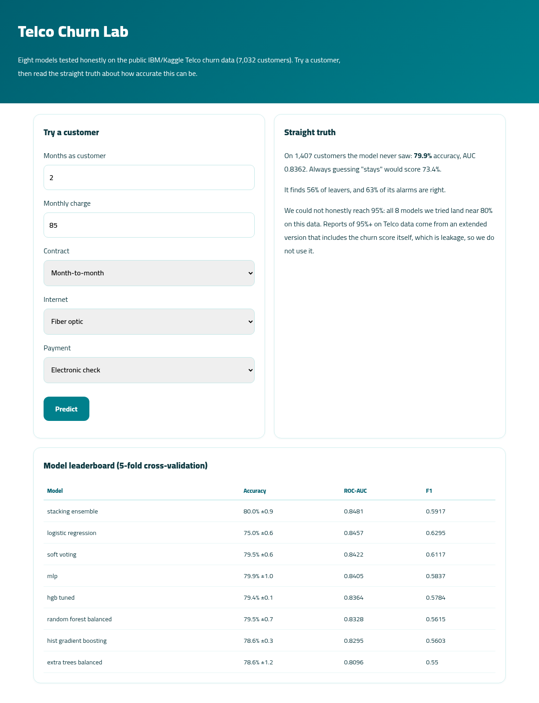

# Telco Churn Lab

Heavy, honest modeling on the public Telco customer churn dataset (7,043 rows, 7,032 after dropping blank TotalCharges). A model zoo, 5-fold CV, a final test used once, and a small web app (predict one customer, leaderboard, honest ceiling).

## Screenshot

Real capture of the app running locally: the customer form, the held-out result and the 5-fold model leaderboard.

## Results (real)
5-fold stratified CV on the 80% train part only (selection happens only here, the 20% test part is not used): stacking ensemble best by AUC (0.8481, accuracy 80.0%), then logistic regression (AUC 0.8457), soft voting, MLP, tuned HGB, random forest, HGB, extra trees. (An earlier version of this repo ran the CV on all rows including the test part; it picked the same model, and the test result below did not change.) Full table: `results/cv_results.json`.

Final test (20%, 1,407 customers, touched once; model chosen by CV on the train part, threshold 0.53 chosen on out-of-fold train predictions): **79.9% accuracy at that threshold (79.5% at the default 0.5), ROC-AUC 0.836**, recall 55.9% and precision 63.0% for the churn class at 0.5. Always predicting "stays" scores 73.4%. See `results/final_metrics.json`.

## Why not 95%
Eight model families, engineered features and stacking all stay near 80% accuracy / 0.84 AUC. That matches the ceiling for these columns. Published 95%+ figures on Telco data use the extended IBM version that contains "Churn Score" / "Churn Reason", which are outcome-derived (leakage). Those columns are not used here.

## Run
    python -m src.benchmark   # CV across the zoo (a few minutes)
    python -m src.final       # final held-out test + saves the model
    python -m pytest -q
    uvicorn src.api:app --port 8000
    docker build -t telco-churn-lab . && docker run -p 8000:7860 telco-churn-lab

Predictions are logged to SQLite (`results/predictions.db`). Built with AI pair-programming; numbers come from real runs.

## Files not in this repo
The trained model file (67 MB) and the Telco CSV are not committed. Download the public Telco churn CSV into `data/Telco-Customer-Churn.csv`, then run `python -m src.benchmark` and `python -m src.final` to recreate `results/telco_model.joblib`. API tests need that model file.

